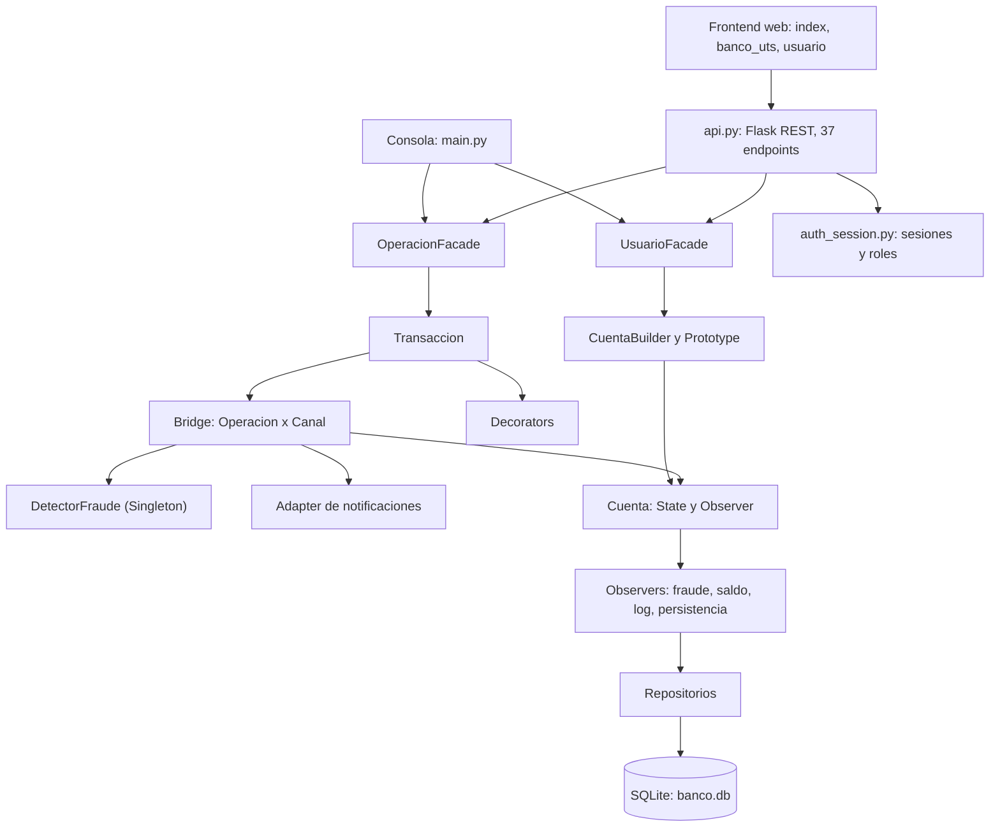

# Sistema Bancario UTS — Patrones de Diseño GoF

API REST bancaria en **Python / Flask** con persistencia **SQLite**, frontend web en HTML/JS vanilla y **14 patrones de diseño GoF** aplicados sobre un dominio financiero.

**Desarrollado por:**

- Brayan Andrés Cañas León
- Juan Sebastián Niño Forero

**Docente:** Eliecer Montero Ojeda
**Institución:** Unidades Tecnológicas de Santander (UTS)

---

## 1. Resumen

Plataforma académica que permite registrar usuarios con verificación KYC, abrir cuentas (corriente y ahorros), operar depósitos, retiros y transferencias por tres canales (Web, Móvil, Cajero), gestionar préstamos con interés fijo o variable, detectar operaciones de riesgo y auditar cada movimiento.

| Aspecto | Detalle |
|---|---|
| Lenguaje / framework | Python 3, Flask 3.0.3 |
| Persistencia | SQLite vía Flask-SQLAlchemy 3.1.1 + migraciones Alembic (Flask-Migrate 4.0.7) |
| Frontend | `index.html` (login), `banco_uts.html` (administrador), `usuario.html` (cliente) |
| Interfaz alterna | Menú interactivo por consola (`main.py`) |
| API | 37 endpoints REST bajo `/api` |
| Autenticación | Sesión por token Bearer con control de rol (admin / usuario) |
| Patrones GoF | 14 implementados |
| Pruebas | 167 pruebas con pytest: 166 pasan y 1 `xfail` documentado |

---

## 2. Funcionalidades

| Módulo | Qué hace | Archivos |
|---|---|---|
| **Usuarios y KYC** | Registro de usuarios y verificación KYC obligatoria antes de abrir cuentas | `usuario.py`, `usuario_facade.py` |
| **Cuentas** | Cuentas corriente y ahorros; saldo con `Decimal` y `ROUND_HALF_UP` a 2 decimales | `cuenta.py`, `cuenta_builder.py` |
| **Operaciones** | Depósito, retiro y transferencia con flujo *validar → detectar fraude → operar → notificar* | `operacion_bridge.py`, `transaccion.py` |
| **Canales** | Web, Móvil y Cajero con límites propios (ver sección 6) | `canal_bridge.py`, `canal_factory.py` |
| **Estados de cuenta** | Activa, Bloqueada, Suspendida y Cerrada, cada una con reglas distintas | `estado_cuenta.py` |
| **Fraude / AML** | 5 reglas evaluadas en cada operación; umbral AML configurable | `detector_fraude.py`, `config_banco.py` |
| **Préstamos** | Creación, pago de cuotas, abonos libres y comparación fijo vs. variable | `prestamo_strategy.py`, `prestamo_repository.py` |
| **Notificaciones** | SMS, Email, Push y Voucher según el canal | `notificador_adapter.py` |
| **Historial y undo/redo** | Comandos reversibles con pila de historial | `command_transaccion.py` |
| **Decoradores configurables** | Tiempo de ejecución, auditoría y reintentos activables por API | `operacion_decorator.py` |
| **Plantillas de cuenta** | Registro y clonación de cuentas modelo | `cuenta_prototype.py`, `prototipo_repository.py` |
| **Jerarquía bancaria** | Banco → Sucursal → Cuenta con saldos agregados | `banco.py`, `sucursal.py`, `componente_bancario.py` |
| **Reporte** | Reporte por sucursal (`/api/reportes/sucursales`) | `api.py` |
| **Logs** | Registro centralizado de eventos, consultable por API | `logger.py` |

---

## 3. Patrones de diseño implementados (14)

### Creacionales

| Patrón | Aplicación | Archivo |
|---|---|---|
| **Singleton** (Double-Checked Locking) | `ConfigBanco`, `Logger`, `DetectorFraude`, `SucursalesManager`; también `HistorialComandos` y `SesionManager` | `config_banco.py`, `logger.py`, `detector_fraude.py`, `sucursales_manager.py` |
| **Factory Method** | Creación de `Deposito`, `Retiro` y `Transferencia` | `operacion_factory.py`, `operacion_bridge.py` |
| **Abstract Factory** | Familias de validador, notificador y límite por canal (`WebFactory`, `MovilFactory`, `CajeroFactory`) | `canal_factory.py` |
| **Builder** | `CuentaBuilder` construye cuentas validando KYC, usuario y sucursal | `cuenta_builder.py` |
| **Prototype** | `CuentaPrototypeRegistry` registra y clona cuentas modelo | `cuenta_prototype.py` |

### Estructurales

| Patrón | Aplicación | Archivo |
|---|---|---|
| **Bridge** | Separa `OperacionBancaria` de `CanalBancario`; eje del sistema | `operacion_bridge.py`, `canal_bridge.py` |
| **Adapter** | Adapta servicios simulados de SMS (Twilio), Email (SendGrid), Push y Voucher a una interfaz común | `notificador_adapter.py` |
| **Decorator** | `LogTiempoDecorator`, `AuditoriaDecorator`, `ReintentoDecorator` | `operacion_decorator.py` |
| **Facade** | `UsuarioFacade` y `OperacionFacade` como punto de entrada | `usuario_facade.py`, `operacion_facade.py` |
| **Composite** | Banco, Sucursal y Cuenta comparten `ComponenteBancario` (saldo total, listado) | `componente_bancario.py`, `banco.py`, `sucursal.py`, `cuenta.py` |

### De comportamiento

| Patrón | Aplicación | Archivo |
|---|---|---|
| **Observer** | `ObservadorFraude`, `ObservadorSaldoCritico`, `ObservadorLogMovimiento` y `ObservadorPersistencia` reaccionan a cada movimiento | `observer_cuenta.py`, `observador_persistencia.py` |
| **Strategy** | Interés fijo (sistema francés) o variable | `prestamo_strategy.py` |
| **Command** | `ComandoDeposito`, `ComandoRetiro`, `ComandoTransferencia` con `deshacer()` y `reejecutar()` | `command_transaccion.py` |
| **State** | `EstadoActiva`, `EstadoBloqueada`, `EstadoSuspendida`, `EstadoCerrada` | `estado_cuenta.py` |

### Patrones GoF no implementados

| Patrón | Estado |
|---|---|
| Memento, Chain of Responsibility, Template Method | Trabajo futuro (restauración de estados, cadena de validaciones y plantilla de reportes) |
| Flyweight | No se implementa formalmente. `CanalBancarioProducer` reutiliza una única instancia por canal, con intención similar |
| Proxy, Iterator, Mediator, Visitor, Interpreter | No aplican al alcance del proyecto |

---

## 4. Arquitectura



El dominio (`cuenta.py`, `banco.py`) no depende de Flask ni de SQLAlchemy. La persistencia se engancha mediante un observador (`ObservadorPersistencia`) y repositorios, sin modificar la lógica de la cuenta.

---

## 5. Estructura del proyecto

```
BANCOSNBC/
├── api.py                      # API REST Flask (37 endpoints)
├── main.py                     # Interfaz de consola
├── auth_session.py             # Sesiones, roles, hash de contraseñas
├── config_banco.py             # Singleton de configuración (AML, ventana, saldo crítico)
├── detector_fraude.py          # Singleton de reglas de riesgo
├── logger.py                   # Singleton de logs
├── cuenta.py, banco.py, sucursal.py, usuario.py, componente_bancario.py
├── operacion*.py, canal_*.py, transaccion.py
├── estado_cuenta.py, observer_cuenta.py, observador_persistencia.py
├── command_transaccion.py, prestamo_strategy.py
├── notificador_adapter.py, operacion_decorator.py
├── cuenta_builder.py, cuenta_prototype.py
├── usuario_facade.py, operacion_facade.py, validaciones.py
├── models.py, database.py, *_repository.py   # Persistencia (SQLAlchemy)
├── migrations/                 # Alembic (Flask-Migrate)
├── seed.py, seed_prestamos.py, seed_db.py    # Datos de prueba
├── index.html, banco_uts.html, usuario.html  # Frontend
├── tests/                      # Suite pytest
├── requirements.txt, requirements-dev.txt, pytest.ini
└── banco.db                    # Base SQLite (generada)
```

---

## 6. Reglas de negocio

### Límites por canal (COP)

| Canal | Mínimo | Máximo |
|---|---:|---:|
| Web | 1.000 | 50.000.000 |
| Móvil | 1.000 | 5.000.000 |
| Cajero | 10.000 | 2.000.000 |

### Estados de cuenta

| Estado | Depósito | Retiro | Transferencia |
|---|:---:|:---:|:---:|
| Activa | ✅ | ✅ | ✅ |
| Suspendida | ✅ | ❌ | ❌ |
| Bloqueada | ❌ | ❌ | ❌ |
| Cerrada | ❌ | ❌ | ❌ |

### Detección de fraude y AML

| # | Regla | Comportamiento |
|---|---|---|
| 1 | Monto superior al umbral AML (`10_000_000` COP, referencia UIAF Colombia) | Genera alerta |
| 2 | 5 o más transacciones en una ventana de 5 minutos | Genera alerta |
| 3 | Retiro o transferencia que dejaría saldo negativo | Genera alerta |
| 4 | Canal distinto a los usados en las últimas 5 transacciones | Genera alerta |
| 5 | Transferencia a cuenta destino sin historial | Solo log informativo, no bloquea |

Los parámetros viven en `config_banco.py`.

### Préstamos

| Estrategia | Cálculo |
|---|---|
| **Fijo** | Sistema francés: cuota constante con la tasa pactada |
| **Variable** | Sistema francés con tasa efectiva = máximo entre la tasa solicitada y DTF simulado (12,5 %) + spread (4,0 %) = 16,5 % |

Incluye pago de cuotas, abonos libres y comparación entre ambas estrategias.

---

## 7. Instalación y ejecución (Windows)

```powershell
cd BANCOSNBC
python -m venv venv
venv\Scripts\activate
pip install -r requirements.txt

# Una sola vez: carga 13 usuarios, sus cuentas, movimientos y 7 préstamos
python seed_db.py

# Servidor en http://127.0.0.1:5000
python api.py
```

Después abre `index.html` en el navegador. El frontend consume `http://127.0.0.1:5000/api`.

Variables de entorno opcionales:

| Variable | Efecto | Defecto |
|---|---|---|
| `FLASK_DEBUG` | `1` activa el modo debug | `0` |
| `CORS_ORIGINS` | Orígenes permitidos, separados por coma | `*` |
| `BANCO_DB_PATH` | Ruta alterna de la base de datos | `banco.db` junto al código |

Consola interactiva alterna: `python main.py`.

---

## 8. Autenticación

1. `POST /api/auth/login` (también `/login/admin` y `/login/usuario`) devuelve un token.
2. Los endpoints sensibles exigen el encabezado `Authorization: Bearer <token>` y validan el rol (`admin` o `usuario`) con el decorador `@requiere_sesion`.
3. Las credenciales del administrador se guardan con hash en la tabla `administradores`. **Cambia las credenciales por defecto** definidas en `administrador_repository.py` antes de cualquier despliegue.

---

## 9. API REST (37 endpoints)

| Grupo | Endpoints |
|---|---|
| **Autenticación** | `POST /api/auth/login`, `/auth/login/admin`, `/auth/login/usuario`, `/auth/logout` |
| **Usuarios** | `POST /api/usuarios/registrar`, `/usuarios/kyc`; `GET /api/usuarios`, `/usuarios/saldos/<documento>`; `DELETE /api/usuarios/eliminar` |
| **Cuentas** | `POST /api/cuentas/crear`; `GET /api/cuentas/movimientos/<numero>`, `/cuentas/titular/<numero>`, `/cuentas/kyc/<numero>` |
| **Estados** | `GET /api/cuentas/estados`, `/cuentas/estado/<numero>`; `POST /api/cuentas/estado` |
| **Operaciones** | `POST /api/operaciones/depositar`, `/retirar`, `/transferir` |
| **Sucursales y reportes** | `GET /api/sucursales`, `/reportes/sucursales`, `/logs` |
| **Prototipos** | `POST /api/prototipos/registrar`, `/prototipos/clonar`; `GET /api/prototipos` |
| **Decoradores** | `POST /api/decoradores/configurar`, `/decoradores/trazabilidad`; `GET /api/decoradores/activos` |
| **Préstamos** | `POST /api/prestamos/crear`, `/prestamos/pagar`, `/prestamos/abonar`, `/prestamos/comparar`; `GET /api/prestamos` |
| **Command** | `POST /api/command/deshacer`, `/command/reejecutar`, `/command/limpiar`; `GET /api/command/historial` |

---

## 10. Modelo de datos

| Tabla | Contenido |
|---|---|
| `usuarios` | Datos del cliente y estado KYC |
| `administradores` | Credenciales del administrador (hash) |
| `sucursales` | Sucursales del banco |
| `cuentas` | Cuentas, tipo, saldo y estado |
| `movimientos` | Historial de transacciones |
| `prestamos` | Préstamos y estrategia de interés |
| `pagos_prestamo` | Pagos y abonos |
| `prototipos_cuenta` | Plantillas de cuenta |
| `configuracion_sistema` | Configuración persistida (p. ej. decoradores activos) |

---

## 11. Pruebas

```powershell
pip install -r requirements-dev.txt
python -m pytest
```

| Archivo | Pruebas |
|---|---:|
| `tests/test_validaciones.py` | 70 |
| `tests/test_auth.py` | 43 |
| `tests/test_prestamos.py` | 25 |
| `tests/test_operaciones.py` | 18 |
| `tests/test_aml.py` | 11 |
| **Total** | **167** (166 pasan, 1 `xfail`) |

---

## 12. Limitaciones conocidas

| # | Limitación |
|---|---|
| 1 | `Cuenta.transferir()` llama a `retirar()`, por lo que cada transferencia queda duplicada en el historial de la cuenta origen y los observadores se disparan dos veces. Está cubierto por un test `xfail` |
| 2 | No hay bloqueo por cuenta: no se garantiza consistencia de saldos bajo operaciones concurrentes sobre la misma cuenta |
| 3 | Las sesiones viven en memoria y no expiran por tiempo |
| 4 | Las contraseñas usan SHA-256 sin sal; para producción se recomienda `bcrypt` o `argon2` |
| 5 | La interfaz de dominio usa `float`; `Decimal` se aplica en el saldo interno de la cuenta |
| 6 | Solo existe el reporte por sucursal |
| 7 | Los proveedores de notificación (Twilio, SendGrid) son simulados |
| 8 | CORS permite cualquier origen por defecto |
